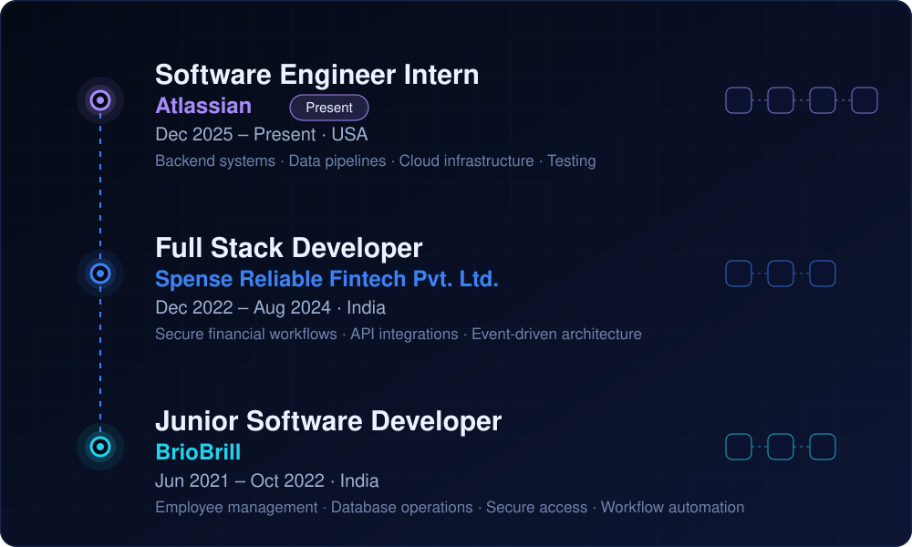

  

---

 
  
  <a href="https://github.com/USERNAME/REPO/stargazers">
   

  

  

  

`JavaScript` `React` `Node.js` `Java` `Spring Boot` `MySQL` `REST APIs` `Role-Based Access Control` `Git`

  
  

