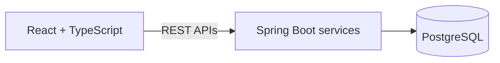

  

---

  
  
  

  

## 💼 Experience

**Software Engineer Intern, Atlassian** · Dec 2025 – Present · USA
- Backend components with Spring Boot, Python and SQL (REST APIs, microservices, PostgreSQL); reduced average response time by **20%** across assigned workflows
- Processed and transformed **50K+ records per day** with Python and PySpark, improving recurring processing efficiency by **40%**
- Worked with Docker, Kubernetes, AWS, Git and CI/CD pipelines
- Added input validation, error handling and data-quality checks; wrote unit, integration and API tests

**Full Stack Developer, Spense Reliable Fintech Pvt. Ltd.** · Dec 2022 – Aug 2024 · India
- Built secure credit card onboarding workflows (React, TypeScript, JavaScript, Node.js) supporting **5,000+ customer applications**; helped increase completion by **22%**
- Worked on Spring Boot and Node.js microservices for onboarding, KYC and asset-backed credit; handled **1,000+ daily requests** and improved API throughput by **17%**
- Built React, TypeScript, GraphQL and SQL dashboards, cutting manual application tracking by **30%**
- Added Kafka event processing, authentication, validation and automated testing, increasing regression coverage by **25%**

**Junior Software Developer, BrioBrill** · Jun 2021 – Oct 2022 · India
- Developed leave, attendance and payroll workflows for the Perk Attendance & Payroll platform, supporting **1,000+ employee records** and improving HR processing efficiency by **18%**
- Built REST API integrations with Java, Spring Boot and MySQL; handled **500+ daily transactions** and reduced data retrieval time by **20%**
- Implemented role-based access control and secure API endpoints; helped reduce recurring defects by **15%**

---

## 🚀 Featured projects

### [E-Commerce Order Management Platform](https://github.com/YOUR-USERNAME/ecommerce-order-management)
`Java` `Spring Boot` `React` `TypeScript` `PostgreSQL` `REST APIs` `Docker` `JUnit`

Full-stack application with customer registration, product management, cart and order-processing workflows. Customer and order operations go through REST APIs with authentication, input validation, exception handling and JUnit tests. Docker keeps setup consistent across environments.

### [Medical RAG Assistant](https://github.com/YOUR-USERNAME/medical-rag-assistant)
`Python` `LangChain` `Llama 3` `Pinecone` `Flask` `Hugging Face Embeddings`

Lets users ask questions and find relevant information across medical documents. PDF extraction, chunking, embeddings and Pinecone vector search feed retrieved context to the LLM through an API workflow.

> ⚠️ Information-retrieval demonstration only. Not a substitute for professional medical advice.

---

## 🎓 Education

- **University of Massachusetts Amherst**: M.S. Business Analytics (Data Science), Sept 2024 – May 2026
- **Jyothy Institute of Technology**: B.E. Information Science, Aug 2019 – Aug 2023

---

## 🤝 Let’s connect

Have an interesting problem to solve? I’m interested in building reliable software, thoughtful full-stack experiences, and systems that turn complex workflows into practical solutions.

[Email me](mailto:incharaanuradha58@gmail.com) · [LinkedIn](https://www.linkedin.com/in/YOUR-LINKEDIN)
