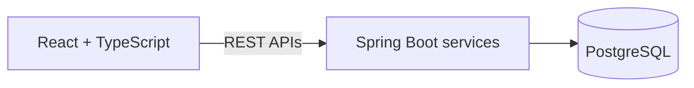

  

---

  
  
  

  

  

  

`JavaScript` `React` `Node.js` `Java` `Spring Boot` `MySQL` `REST APIs` `Role-Based Access Control` `Git`

---

## Impact highlights

Each figure belongs to the role listed beside it.

| Role | Highlight |
|---|---|
| **Atlassian** | **50K+** records processed daily |
| **Atlassian** | **40%** improvement in recurring processing efficiency |
| **Atlassian** | **20%** reduction in average response time |
| **Spense** | **5,000+** customer applications supported |
| **Spense** | **17%** improvement in API throughput |
| **Spense** | **25%** increase in automated regression coverage |
| **BrioBrill** | **1,000+** employee records supported |
| **BrioBrill** | **18%** improvement in HR processing efficiency |
## 🚀 Featured projects

### [E-Commerce Order Management Platform](https://github.com/YOUR-USERNAME/ecommerce-order-management)
`Java` `Spring Boot` `React` `TypeScript` `PostgreSQL` `REST APIs` `Docker` `JUnit`

Full-stack application with customer registration, product management, cart and order-processing workflows. Customer and order operations go through REST APIs with authentication, input validation, exception handling and JUnit tests. Docker keeps setup consistent across environments.

### [Medical RAG Assistant](https://github.com/YOUR-USERNAME/medical-rag-assistant)
`Python` `LangChain` `Llama 3` `Pinecone` `Flask` `Hugging Face Embeddings`

Lets users ask questions and find relevant information across medical documents. PDF extraction, chunking, embeddings and Pinecone vector search feed retrieved context to the LLM through an API workflow.

> ⚠️ Information-retrieval demonstration only. Not a substitute for professional medical advice.

---

## 🎓 Education

- **University of Massachusetts Amherst**: M.S. Business Analytics (Data Science), Sept 2024 – May 2026
- **Jyothy Institute of Technology**: B.E. Information Science, Aug 2019 – Aug 2023

---

## 🤝 Let’s connect

Have an interesting problem to solve? I’m interested in building reliable software, thoughtful full-stack experiences, and systems that turn complex workflows into practical solutions.

[Email me](mailto:incharaanuradha58@gmail.com) · [LinkedIn](https://www.linkedin.com/in/YOUR-LINKEDIN)
