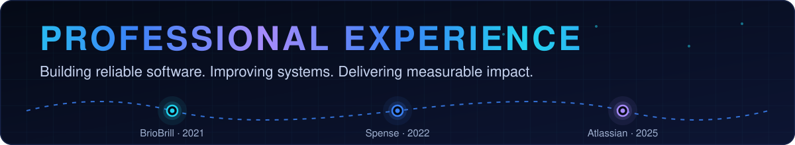
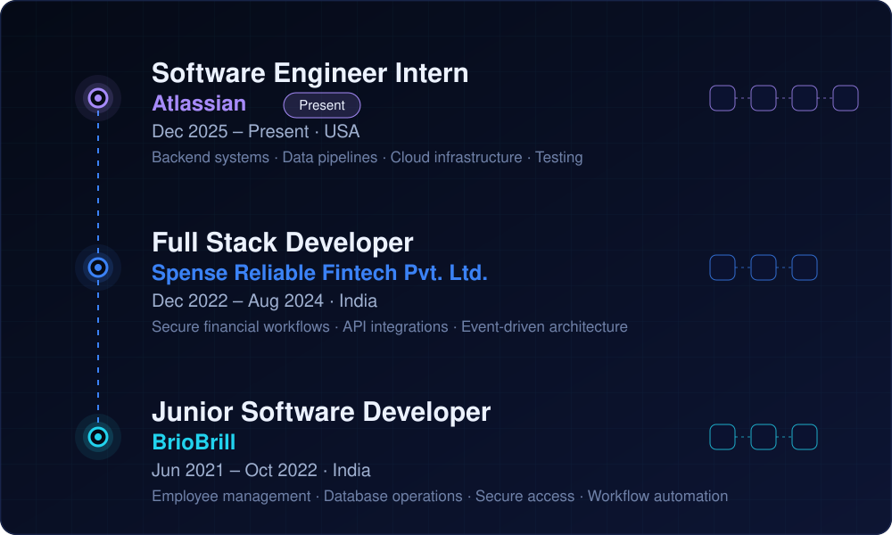
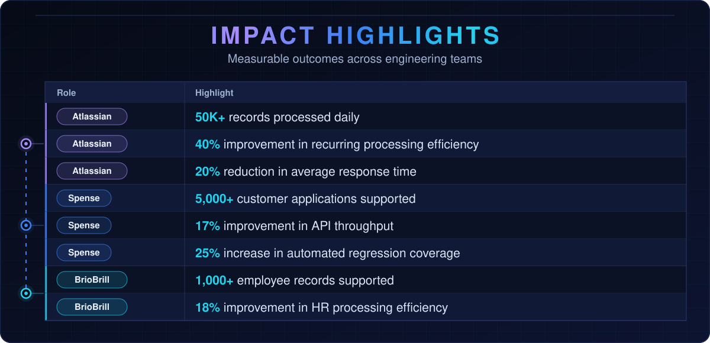

  

---

  
  
  

  

  

  

`JavaScript` `React` `Node.js` `Java` `Spring Boot` `MySQL` `REST APIs` `Role-Based Access Control` `Git`

---

  

## 🤝 Let’s connect

Have an interesting problem to solve? I’m interested in building reliable software, thoughtful full-stack experiences, and systems that turn complex workflows into practical solutions.

[Email me](mailto:incharaanuradha58@gmail.com) · [LinkedIn](https://www.linkedin.com/in/YOUR-LINKEDIN)
